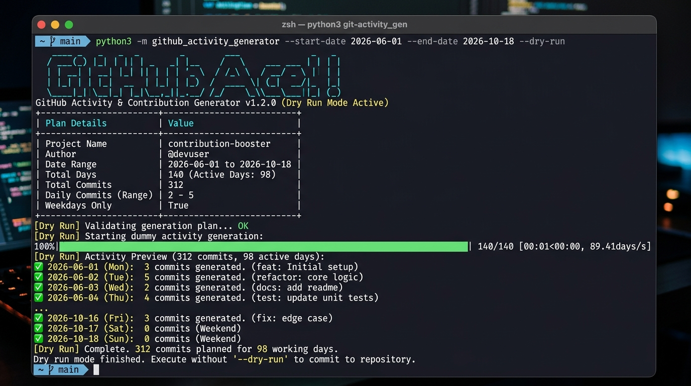

# GitHub Activity & Contribution Generator

A modern, customizable Python CLI tool to simulate Git commit activity and design natural GitHub contribution calendars.

[](https://www.python.org/)
[](LICENSE)
[](https://github.com/hamzach9410/github-activity-generator/actions)
[](CONTRIBUTING.md)

---

## Visual Preview



---

## Key Features

- **Custom Historical Date Ranges**: Generate commit histories across any range (`--start-date`, `--end-date`).
- **Natural Weekday Scheduling**: Automatically filters out weekends (Saturday & Sunday) to replicate real developer work patterns.
- **Configurable Daily Bounds**: Specify `--min-commits` and `--max-commits` to prevent unnatural volume spikes.
- **Business Hours Distribution**: Commits are generated during realistic daylight and evening hours with randomized spacing.
- **Dry-Run Preview**: Inspect dates, message previews, and volume counts before writing a single Git commit.
- **Zero External Dependencies**: Pure Python standard library. Works out of the box with zero third-party packages.

---

## Project Structure

```text
github-activity-generator/
├── .github/
│   └── workflows/
│       └── ci.yml             # Automated CI test suite
├── assets/
│   └── demo.png               # Terminal preview screenshot
├── src/
│   └── github_activity_generator/
│       ├── __init__.py        # Package exports & version
│       ├── __main__.py        # python -m execution entry
│       ├── cli.py             # Argument parsing & formatting
│       ├── core.py            # Scheduling engine & Git runner
│       └── constants.py       # Configuration & message pools
├── tests/
│   ├── __init__.py
│   ├── test_cli.py            # CLI argument & date parsing tests
│   └── test_core.py           # Core scheduling & monotonicity tests
├── .gitignore
├── generator.py               # Root quick-start wrapper
├── LICENSE                    # MIT License
├── pyproject.toml             # Standard PEP 621 packaging
├── README.md                  # Documentation
└── requirements-dev.txt       # Development dependencies
```

---

## Quickstart

### Option 1: Direct Clone & Run

```bash
git clone https://github.com/hamzach9410/github-activity-generator.git
cd github-activity-generator
```

Run directly with Python:

```bash
# Preview schedule with dry-run
python3 generator.py --dry-run

# Run for past 90 days on weekdays
python3 generator.py --start-date 2026-07-01 --end-date 2026-10-18
```

### Option 2: Install as Global CLI via Pip

```bash
pip install -e .
```

Now you can run the command from any repository on your system:

```bash
github-activity-generator --dry-run
github-activity-generator --start-date 2026-01-01 --end-date 2026-06-30 --min-commits 2 --max-commits 4
```

---

## Usage Guide & Examples

### 1. Safe Dry-Run (Always recommended first)
Preview planned dates and messages without touching your Git repository:

```bash
python3 generator.py --start-date 2026-06-01 --end-date 2026-10-18 --dry-run
```

### 2. Generate Commits for a Custom Range
```bash
python3 generator.py --start-date 2026-01-01 --end-date 2026-06-30
```

### 3. Target a Specific Repository
Specify the target repository folder using `--path`:

```bash
python3 generator.py --path /path/to/your/repo --start-date 2026-05-01 --end-date 2026-08-31
```

### 4. Push to GitHub
After generation, push to your remote branch:

```bash
git push origin main
```

---

## CLI Options

| Option | Type | Default | Description |
|---|---|---|---|
| `--start-date` | `YYYY-MM-DD` | `90 days ago` | Target commit start date |
| `--end-date` | `YYYY-MM-DD` | `Today` | Target commit end date |
| `--min-commits` | `int` | `2` | Minimum commits per active day |
| `--max-commits` | `int` | `5` | Maximum commits per active day |
| `--include-weekends` | `flag` | `False` | Include Saturday & Sunday (default: weekdays only) |
| `--dry-run` | `flag` | `False` | Preview commit plan without writing changes |
| `--path` | `str` | `.` | Target Git repository directory |

---

## Running Tests

Execute the automated test suite using `unittest`:

```bash
python3 -m unittest discover -s tests -p "test_*.py"
```

Or using `pytest`:

```bash
pip install -r requirements-dev.txt
pytest
```

---

## Disclaimer

This project is created for developer testing, simulation of Git contribution charts, and educational automation workflows. Please use responsibly on repositories you own or manage.

---

## License

This project is licensed under the [MIT License](LICENSE).
